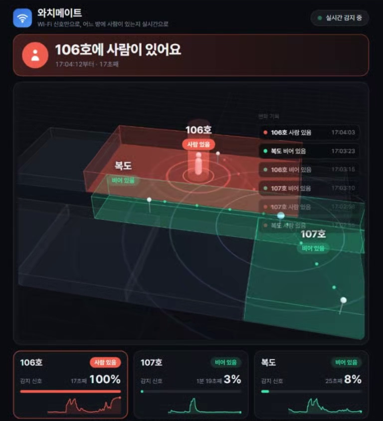

# 와치메이트 프론트엔드 (WOOWANGTHON_TEAM_16_FE)

와치메이트는 불이 난 건물에서 문을 열기 전에, 와이파이 신호만으로 방 안의 기척을 지휘관에게 알려 주는 서비스예요.
카메라 없이, 빈 방일 때의 신호와 지금 신호를 비교해 구역마다 상태를 보여 줘요. 2026 AI 우왕톤 16팀 출품작이에요.

이 저장소에는 화면이 들어 있어요. 판정 서버와 AI, 보드 펌웨어는 [WOOWANGTHON_TEAM_16_BE](https://github.com/woowangthon/WOOWANGTHON_TEAM_16_BE)에, 공개 데이터 시험은 [WOOWANGTHON_TEAM_16_AI](https://github.com/woowangthon/WOOWANGTHON_TEAM_16_AI)에 있어요.



시연 영상의 한 장면이에요(실제 건물 1층, 사람이 106호 안에 있을 때). 영상은 문구를 바꾸기 전에 찍어서 다른 구역이 '비어 있음'으로 보여요. 지금 코드는 '감지 안 됨'으로 표시해요. 가만히 누운 사람은 놓칠 수 있어서, 사람이 없다는 뜻으로 읽히지 않게 바꿨어요.

## 바로 써 보기

- 화면: https://watchmate-16.vercel.app (테스트 계정은 제출 폼에 적은 아이디·비밀번호)
- 로그인하면 첫 화면에 **보드 없이 바로 보기** 칸이 있어요. **녹화 재생 시작 · 4배속**을 누르면 11/8에 실제 건물에서 녹화한 신호 2분을 서버가 그 자리에서 다시 처리해요. 배속은 화면에 표시되고, 실제 속도로도 볼 수 있어요. (같은 기능이 **고급 설정**의 **녹화 재생(시연)** 칸에도 있어요.)
- 재생 화면에는 도면, 녹화할 때 적어 둔 실제 상황, 화면 판정이 바뀐 순간이 나란히 나와요. 녹화 시각으로 처음 50초쯤은 세 구역이 모두 조용하고, 사람이 223호에 들어선 0:53 뒤에 223호가 '신호 변화 큼'으로 바뀌어요.
- 서버가 무료 요금제(CPU 0.1개)라 처음 접속하면 깨어나는 데 1분쯤, 재생을 누른 뒤 빈 방 기준을 계산하는 데 30초쯤 걸려요. 4배속 재생은 그 뒤 30초쯤이에요.
- 로그인 없이 화면 구성만 보려면 로그인 화면의 "서버 없이 UI 예시(가상 데이터)로 보기"를 누르세요. 가상 데이터라는 표시가 항상 붙어요.

## 이 저장소에 있는 것

| 폴더 | 내용 |
|---|---|
| `src/` | 실험 화면(React). 보드 연결부터 빈 방 보정, 감지, 기록까지 한 페이지에서 진행해요 |
| `demo_split/` | 시연 영상용 분할 화면. 왼쪽에 실시간 판정(3D 도면), 오른쪽에 휴대폰 카메라를 나란히 띄워 그대로 녹화해요. 쓰는 법은 [demo_split/README.md](demo_split/README.md) |
| `scripts/` | 현장 측정 도우미. 화면과 녹화를 맞추는 `record_live.py`, 장면별로 다시 채점하는 `judge_by_scene.py`, 수집기를 켜는 `start_collector.py` |
| `tests/` | 측정 흐름 시험(보정 다시 하기, 보드 재시작) |

실험 화면은 세 부분이에요.

- **실험 진행** (첫 화면, 한 페이지): 1~7단계를 위에서부터 차례대로 해요. 단계마다 '하기 전에 → 버튼 → 누른 뒤에'를 적어 두었고, 서버 상태를 보고 끝난 단계는 저절로 '완료'가 되며 다음 단계가 열려요.
- **기록**: 실제 상태별 일치·오탐·미탐 건수, 반응 지연, CSV 내보내기
- **고급 설정**: 보고 있는 공간 바꾸기, 수신기 토큰 다시 발급, 수집기 서버 주소, 녹화 재생, UI 예시 전환

## 쓴 도구

React 18, TypeScript, Vite, Tailwind CSS로 만들었어요. 시연용 분할 화면은 파이썬 표준 라이브러리 서버와 three.js(3D 도면)를 써요.

## 실행

Node 20 이상이 필요해요. 이 저장소를 받은 폴더에서:

```powershell
npm install
npm run dev
```

브라우저에서 http://localhost:5173 을 열어요. `/api` 요청은 개발 서버가 `127.0.0.1:8000`(백엔드)으로 넘겨요.

백엔드는 [BE 저장소](https://github.com/woowangthon/WOOWANGTHON_TEAM_16_BE)를 받은 폴더에서 따로 켜요. 가상 환경을 만드는 방법은 BE README의 "로컬 실행"에 있어요.

```powershell
.\.venv\Scripts\python -m uvicorn app.main:app --port 8000
```

로그인 기본값은 `demo` / `demo1234`예요(백엔드 `DEMO_USERNAME`, `DEMO_PASSWORD`). 서버 없이 화면만 보려면 로그인 화면의 "UI 예시(가상 데이터)로 보기"를 눌러요.

## 실험 순서

'실험 진행' 화면에 그대로 나와요.

1. 서버 켜기
2. 실험 공간 등록(처음 한 번): 구역 3개와 보드 4개가 등록되고 수신기 토큰이 이 브라우저에 저장돼요.
3. 보드 켜고 수집기 실행: 보드 전원을 켜고 게이트웨이를 꽂은 뒤 `start-collector.bat`을 두 번 눌러요(또는 화면의 '자동 실행 명령 복사'). 게이트웨이 포트를 스스로 찾고, TX-1·수신기 3개를 점검해 안 되는 보드와 고칠 점을 알려 준 뒤, 서버에서 토큰을 받아 수집기를 켜요. 점검만 하려면 `start-collector.bat --check`.
4. 기준선 보정: 모두 방 밖으로 나가서 해요.
5. 감지 시작
6. 실험하기: 실제 상태가 바뀌는 순간 버튼을 눌러요(직전 시도가 자동 저장).
7. 마치기: 감지 끄기, 기록 CSV 내려받기.

## 현장 측정 · 화면과 녹화를 자동으로 맞추기

측정 PC에서 두 저장소를 나란히 두고, 위 실행 절차대로 백엔드와 Vite를 켜세요. 브라우저에서 로그인한 뒤 **실험 진행** 페이지를 열어 두세요. 다른 수집기가 게이트웨이를 사용 중이면 먼저 종료하세요. 모든 구역을 비운 상태로 백엔드 폴더에서 아래 명령을 실행합니다. 게이트웨이 포트와 이번 측정의 날짜·새 출력 폴더는 현장에 맞추세요.

```powershell
$env:WATCHMATE_GATEWAY="COM7"
.\.venv\Scripts\python.exe ..\watchmate-fe\scripts\record_live.py `
  --plan docs/field_tests/2026-11-07/plans/fourth_plan.csv --day 2026-11-08 `
  --out ..\data\sessions\2026-11-08 --node RX-301=gw --node RX-302=gw --node RX-COR=gw --countdown 20
```

한 번 측정할 때마다(보정부터 마지막 장면까지) `--day`와 `--out`을 새로 줍니다. 예: 1회차 `2026-11-08`, 2회차 `2026-11-08b`, 3회차 `2026-11-08c`. `--day`는 측정 이름표예요. 학습은 `--day`마다 그 측정의 빈 방으로 기준선을 잡고, 측정 하나씩 빼고 채점합니다.

1. 실험 화면이 공간·구역·수신기를 자동으로 등록하거나 기존 설정을 사용합니다. 화면이 준비되고 세 보드의 입력이 들어오면 빈 방을 180초 보정합니다. 시작 전에 구역을 비우고 첫 장면 안내까지 기다리세요. 진행 중인 다른 감지나 보정이 있으면 도우미가 알려 줍니다.
2. 보정 결과를 점검합니다. 수신기 하나라도 문턱이 3을 넘거나(빈 방이면 2 안팎) 판정이 60개보다 적으면, 20초 뒤 한 번 더 보정합니다. 두 번째도 그러면 본 측정 없이 멈춥니다. 아무도 없는데도 문턱이 계속 높으면 `--max-tau 4`처럼 기준을 올릴 수 있어요(그만큼 사람을 덜 잡아요). 이번 보정에 모든 대상 수신기가 성공하면 도우미가 감지를 시작합니다. 브라우저가 해당 실측의 장면 이름과 라벨을 표시한 뒤 이동 시간을 시작하고, 수신 상태와 화면을 다시 확인하고 녹화합니다.
3. 실험자는 화면 안내에 맞춰 움직입니다. 계획표의 장면·구역 라벨이 자동으로 입력되며, 자세 입력과 다음 장면 버튼을 누를 필요가 없습니다. 계획표 라벨은 실험자가 하기로 한 동작을 뜻합니다. 실제로 다른 동작을 했다면 그 장면은 따로 확인하세요.
4. 측정 도중 실험 탭을 닫거나 페이지·서버·실시간 전송이 끊긴 상태가 지속되면 진행 중인 장면을 취소하고 같은 장면을 다시 시작합니다. 연속 원본을 보존하고 취소된 구간은 완성된 장면 CSV에서 제외합니다. 완료된 장면은 같은 브라우저에 구역별 결과가 저장된 뒤 다음으로 넘어갑니다. 마지막에는 이번 실측이 시작한 감지를 자동 종료합니다.
   - 보정 뒤 첫 빈 방 장면에서 '가능' 이상(p ≥ 0.20)이 20%를 넘는 수신기가 있으면, 보정 직후 신호가 움직인 것으로 보고 그 장면 파일을 녹화 폴더 안 `excluded_recal`로 옮긴 뒤(지우지 않음) 다시 보정하고 빈 방 장면부터 다시 찍습니다(최대 2번). 6차 223호가 보정 2~3분 뒤 RSSI가 1dB 내려가 빈 방·옆 구역 헛경보가 이어진 경우를 막기 위한 점검입니다. 시험: `tests/recording_recal_headless.py`(다시 보정 흐름), `--pass`(평소 흐름).
5. 보정 뒤 보드가 다시 켜지면(전원이 잠깐 빠짐) 측정을 멈추고, 끊긴 장면부터 이어 찍는 명령을 창에 적어 줍니다(`--day`·`--out` 새 값, `--start 끊긴 장면`). 끝난 장면은 그대로 쓰고, 새 측정은 빈 방 보정부터 다시 합니다.
6. 기록 화면에서 결과 CSV를 내려받을 수 있습니다. 보드 원본·장면 CSV는 명령의 `--out`에 저장됩니다. 서버와 화면 없이 기존 수집기를 쓰려면 `--no-live --yes`를 추가하세요. 화면 동기화는 측정 PC의 Vite `/rec/` 프록시를 사용합니다.

실험 탭을 전면에 두세요. 화면 저장 공간이 가득 찼거나, 대상 보드가 보내지 않거나, 녹화 도우미 포트를 다른 프로그램이 쓰면 해당 상태를 해결해야 진행됩니다. 빈 방 기준선 보정 시간을 바꾸려면 `--calibration-seconds`를 지정하세요(기본 180).

### 판정 기준

서버가 구역 상태와 첫 감지 이벤트에 같은 평활 점수를 사용합니다. 1단계 신호 변화의 문턱은 0.50·0.20이고, 학습 모델은 0.70·0.35입니다. 화면은 서버가 준 구역 상태를 사용합니다. 이전 서버와 연결한 경우에는 기존 화면의 1단계 문턱을 적용합니다.

0.50·0.20은 11/7 측정(RSSI 고침 전 서버)으로 정한 값이라, 첫 회차 빈 방 장면에서 확인합니다. 바꾸려면 서버를 켜기 전에 `$env:MEASURE_DETECT_P="0.6"`, `$env:MEASURE_POSSIBLE_P="0.3"`처럼 주거나 백엔드 `.env`에 적으세요. 이미 찍은 측정은 서버에 저장된 p로 다른 기준을 넣어 다시 채점할 수 있어요: `python ..\watchmate-fe\scripts\judge_by_scene.py --session ..\data\sessions\2026-11-08 --present 0.6 --empty 0.3`.

## 지키는 원칙 (기획서)

- 실제 상태 입력은 **채점에만** 쓰고 예측 계산에는 쓰지 않아요.
- 화면 위에 데이터 출처(실시간 · 기록 재생 · UI 예시)와 모델 상태(모델 미연결이면 "신호 변화"로 표시)를 항상 보여 줘요.
- 장치 연결 상태는 사람 상태와 따로 보여 줘요.
- 검증되지 않은 정확도 %는 보여 주지 않고 건수만 세요.
- 모델은 사람이 있는지만 판단해요. 자세는 기록만 하고 채점하지 않아요.
- 도면은 구역 단위예요. 구역 안 정확한 위치나 인원수는 알 수 없어요.

## 저장 위치

실험 기록, 예측 기록, 수신기 토큰은 이 브라우저의 localStorage에 있어요. 다른 PC나 브라우저와 공유되지 않으니 CSV로 내보내 두세요.

## 배포 (Vercel, 무료)

- Vercel에서 이 저장소를 가져오면(Import) Vite 설정을 알아서 잡아요. 빌드 명령 `npm run build`, 결과 폴더 `dist`.
- 환경 변수 `VITE_API_BASE`에 백엔드 주소(예: `https://watchmate-api.onrender.com`)를 넣어요. 바꾼 뒤에는 다시 배포해야 반영돼요.
- 백엔드(Render) 환경 변수 `CORS_ORIGINS`에 이 화면 주소(예: `https://watchmate-fe.vercel.app`)를 넣어요.
- `main`에 푸시하면 Vercel이 자동으로 다시 배포해요. `vercel.json`은 `/devices` 같은 주소에서 새로 고쳐도 404가 나지 않게 해요.
- 무료 백엔드는 15분 동안 쓰지 않으면 잠들어요. 화면은 깨는 동안 "서버를 깨우는 중"을 보여 주고 알아서 다시 연결해요.
